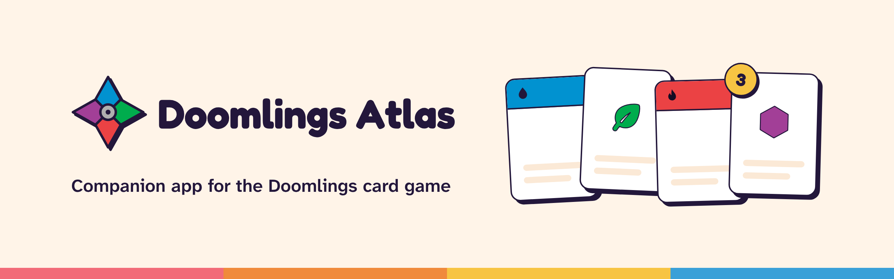
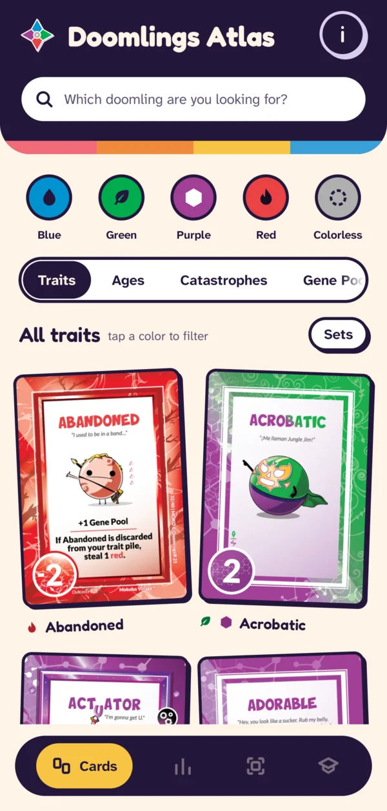
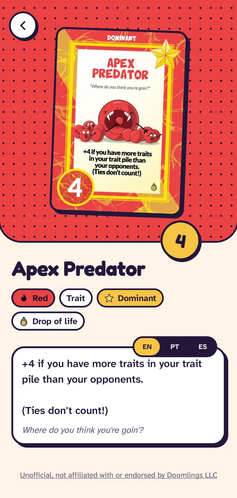
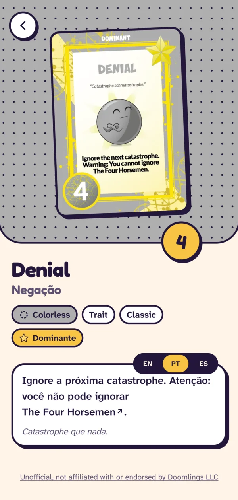

<picture>
  <source media="(prefers-color-scheme: dark)" srcset="design/brand/banner/banner-dark.png">
  <source media="(prefers-color-scheme: light)" srcset="design/brand/banner/banner-light.png">
  
</picture>
  

**Unofficial, not affiliated with or endorsed by Doomlings LLC.**

 

## About

Doomlings Atlas is a free and open-source companion app for the Doomlings card game. Look up the Traits, Ages and Catastrophes of the Classic base game, read their text in English, Portuguese or Spanish, and jump to the cards they mention. It works offline, with no ads, no account and no paid features.

## Features

- **Compendium:** every Trait, Age and Catastrophe of the Classic base game, with its card image.
- **Search and filters:** find a card by name, or filter by color and by Traits, Ages and Catastrophes.
- **Card text in three languages:** as printed in English, or translated into Portuguese and Spanish, switched from any card.
- **Linked cards:** a card named in another card's text opens with a tap, and back returns to where you were.
- **Card groups:** cards that share a name, like the Kidneys, stack into one and open in place.
- **Day and Game night:** light and dark themes, and a layout for tablets and foldables.
- **Offline:** everything ships inside the app.

## Screenshots

<table>
  <tr>
    <td align="center">
      <picture>
        <source media="(prefers-color-scheme: dark)" srcset="assets/doomlings/screenshots/compendium-dark.webp">
        
      </picture>
    </td>
    <td align="center">
      <picture>
        <source media="(prefers-color-scheme: dark)" srcset="assets/doomlings/screenshots/card-dark.webp">
        
      </picture>
    </td>
    <td align="center">
      <picture>
        <source media="(prefers-color-scheme: dark)" srcset="assets/doomlings/screenshots/translated-dark.webp">
        
      </picture>
    </td>
  </tr>
  <tr>
    <td align="center">Compendium</td>
    <td align="center">Card detail</td>
    <td align="center">Card text in Portuguese</td>
  </tr>
</table>

## Download

Get the APK from the [latest release](https://github.com/nycocado/doomlings-atlas/releases/latest) and open it on your phone (Android 8.0 or newer). Since the app doesn't come from Google Play, Android asks once to allow installs from your browser or file manager.

## Roadmap

Next come every Doomlings set and every kind of card in the compendium, scoring a finished game, a card scanner and a tutorial. The plan and its progress are in [ROADMAP.md](ROADMAP.md).

## Contributing

You don't need to code to help: card data fixes, translations, bug reports and ideas all count. Start at [CONTRIBUTING.md](CONTRIBUTING.md).

## Acknowledgements

- Jess and the Doomlings team, for allowing this project and for the high-resolution card images provided to the community.
- Ryeera, for the [Doomlings Tabletop Simulator mod](https://steamcommunity.com/sharedfiles/filedetails/?id=3151925153) the card images come from.

## License

The source code is licensed under the [GPL-3.0](LICENSE).

Doomlings card images, card text, rulebook content and the Doomlings name are © Doomlings LLC, used with permission, and are **not** covered by this repository's open-source license.
